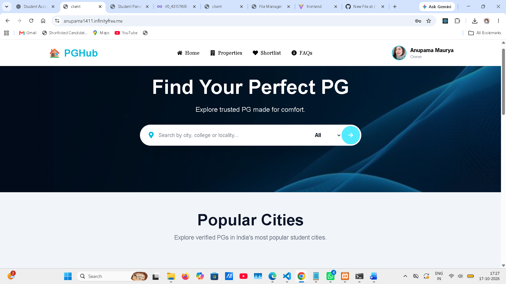
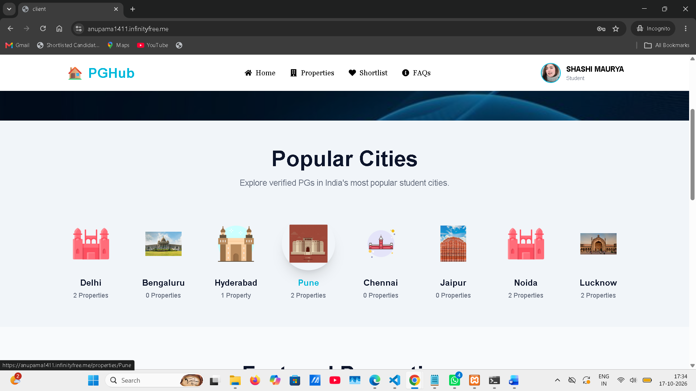
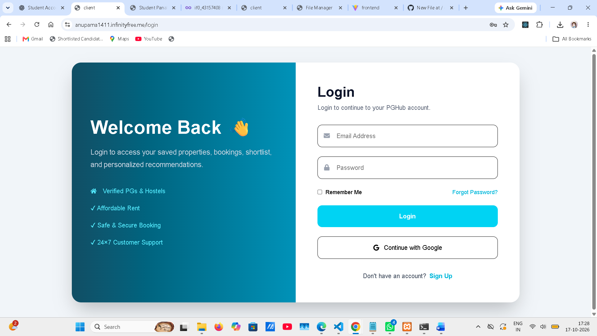
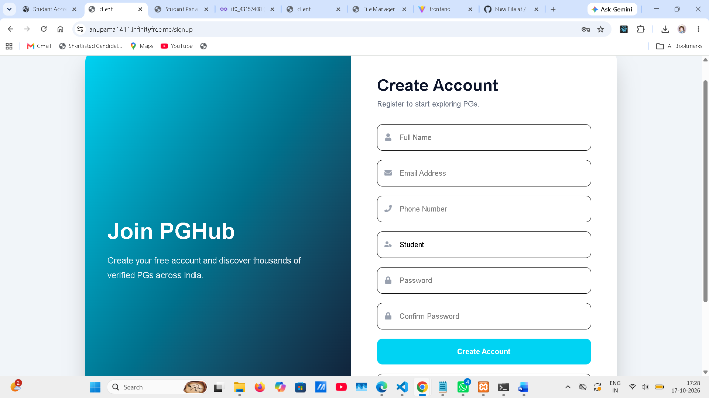

# PGHub – Student Accommodation Platform

PGHub is a student accommodation platform designed to help students explore PG (Paying Guest) properties and find suitable accommodation.

**Live Website:** https://anupama1411.infinityfree.me/

## Table of Contents

- Overview
- Features
- Screenshots
- Technology Stack
- Project Structure
- Getting Started
- API Endpoints
- Future Improvements
- Author

## Overview

Finding suitable student accommodation can be challenging. PGHub aims to make the process easier by presenting PG property information in one place through a responsive website.

## Features

- Browse PG property listings.
- View property name, location, price, and property type where available.
- Explore featured properties and popular cities where implemented.
- Responsive user interface.
- Login and signup pages, if enabled.
- PHP API integration with MySQL.

## Screenshots

### Homepage



### Featured Properties



### Popular Cities


### Login Page



### Signup Page



> Upload your actual screenshots to the `screenshots` folder using these filenames. Otherwise, the images will not appear.

## Technology Stack

- Frontend: React.js, Vite, Tailwind CSS, JavaScript
- Backend: PHP
- Database: MySQL
- Tools: VS Code, Git, GitHub, XAMPP

## Project Structure

```text
PG-Hub/
├── client/
├── server/
├── screenshots/
└── README.md
```

## Getting Started

### Prerequisites

- Node.js and npm
- XAMPP
- Web browser

### 1. Clone the Repository

Replace the URL with your actual repository URL.

```bash
git clone YOUR_GITHUB_REPOSITORY_URL
cd PG-Hub
```

### 2. Configure the Backend

1. Place the project in your XAMPP `htdocs` directory.
2. Start Apache and MySQL.
3. Create or import the required database using phpMyAdmin.
4. Configure the database credentials in your PHP configuration file.
5. Confirm the frontend API URL points to your local PHP backend.

### 3. Run the Frontend

Open a terminal in the `client` folder:

```bash
npm install
npm run dev
```

Open the local URL shown by Vite.

> Follow the database schema and configuration files in your project for exact settings. Never upload database passwords or API secrets to GitHub.

## API Endpoints

Confirm these endpoints exist before using them:

- `server/api/properties/getFeaturedProperties.php`
- `server/api/properties/getPopularCities.php`
- `server/api/auth/login.php`

## Future Improvements

- Improve property search and filtering.
- Add more property photos and details.
- Improve property-owner management.
- Enhance authentication and validation.
- Improve mobile responsiveness and accessibility.

## Author

**Anupama Maurya**

- GitHub: https://github.com/dollyanu

---

If you find PGHub useful, explore the project and share feedback.
